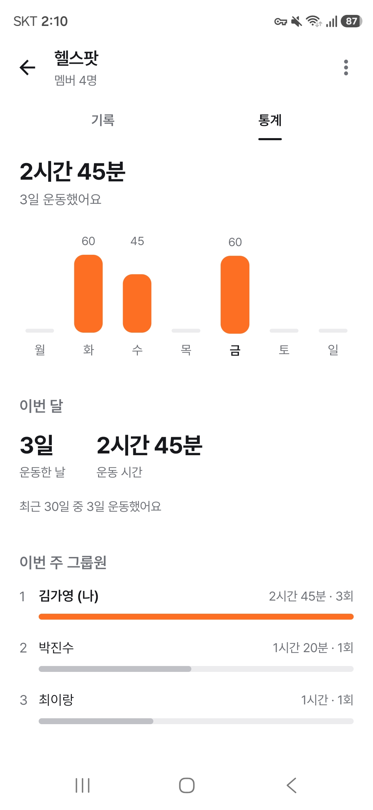
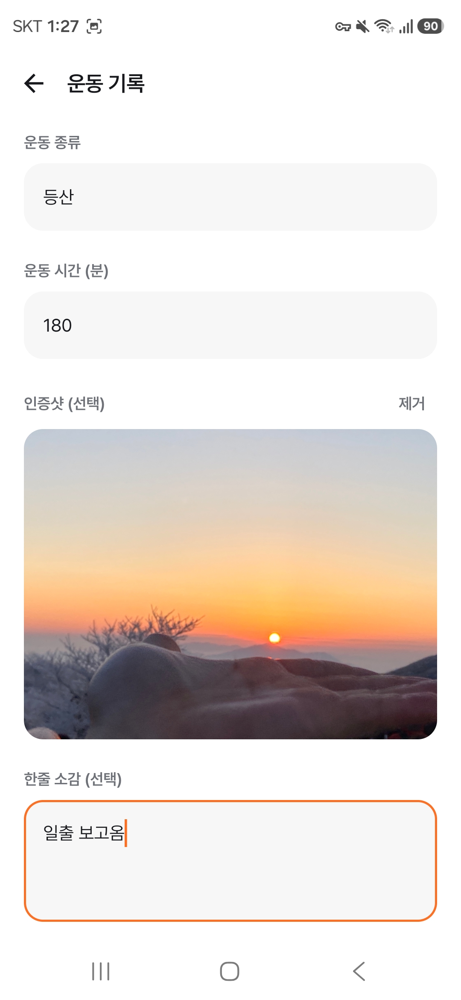
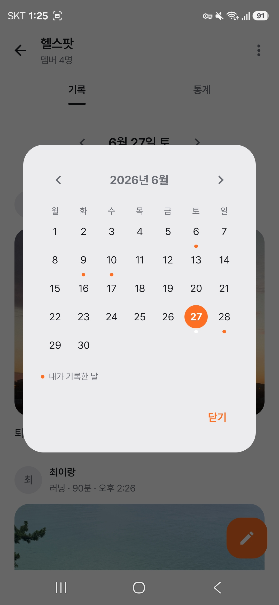
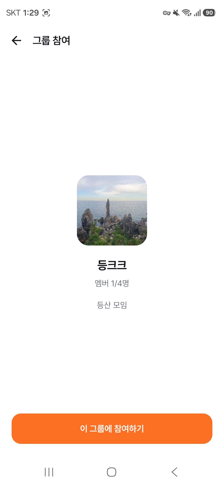
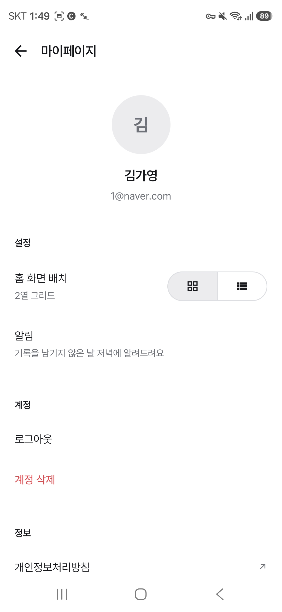
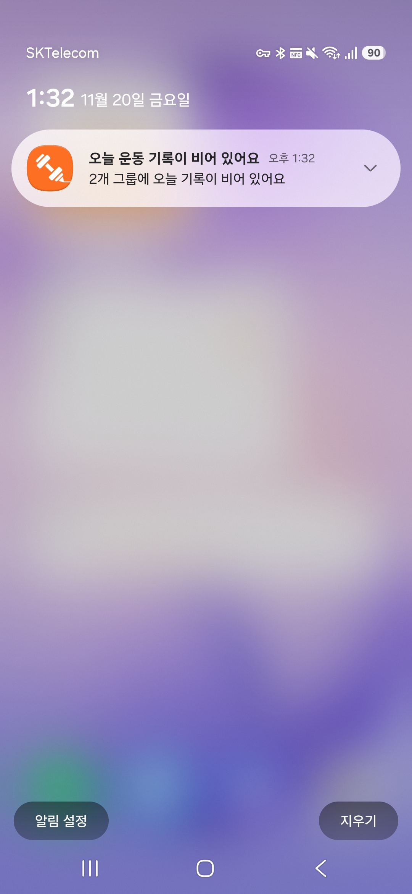

# 💪 헬품타 (Helpumta)

[](https://play.google.com/store/apps/details?id=com.jinsupark.helpumta)

친구들과 그룹을 만들어 운동 기록을 공유하고, 하루의 기록을 한 장의 이미지로 추출하는 Android 운동 기록 앱입니다.

> **Google Play 정식 출시 (2026.08)** — 비공개 테스트 12명 / 14일 요건을 거쳐 프로덕션 출시까지 완료했고, 이후에도 통계 · 푸시 알림 · 홈 화면 위젯을 추가하며 운영 중입니다. (현재 v1.0.4)

> 열품타(열정을 품은 타이머)의 운동 버전 컨셉으로, 멀리 있는 운동 친구들과 서로 자극받으며 운동 습관을 유지하는 것을 목표로 합니다.

> **본 프로젝트는 Clean Architecture + MVI 패턴의 일관된 적용을 핵심 목표로 한 개인 포트폴리오 프로젝트입니다.**

> 🔁 이 앱을 Flutter로 재구현하고 두 플랫폼의 설계 차이를 비교한 프로젝트: [헬품타 Flutter](https://github.com/JinsuPark01/helpumta-flutter)
---

## 🎥 Demo / 📷 Screenshots

|           홈           |        그룹 상세         |          통계           |         사진 추출          |
|:---------------------:|:--------------------:|:---------------------:|:----------------------:|
|     |  |  |     |
|       운동 기록 작성        |        날짜별 조회         |         그룹 참여          |         마이페이지          |
|   |    |     |    |
|      홈 화면 위젯 3종       |       리마인더 알림        |          로그인          |                        |
|   |     |    |                        |

---

## 📌 Overview

친구 그룹 단위로 운동 기록을 공유하는 앱입니다. 그룹원이 각자 운동을 인증하면, 하루치 기록을 모아 **분할 화면 이미지로 추출**할 수 있습니다. (셋로그(Setlog) 스타일)

핵심 사용 흐름:

- 그룹 생성 / 초대 링크(딥링크)로 참여 (최대 4명)
- 운동 종목 · 시간 · 인증샷 · 한줄 소감 기록 (하루 1회)
- 날짜별로 그룹 기록 조회
- 당일 본인 기록 수정 / 기록 삭제
- 선택한 날짜의 기록을 한 장의 이미지로 추출 (미기록자는 zzz 처리)
- 그룹별 주간 · 월간 운동 통계와 그룹원 비교
- 기록이 없는 날 저녁 리마인더 알림 (FCM)
- 홈 화면 위젯 3종으로 앱을 열지 않고 오늘 현황 확인

---

## 🛠 Tech Stack

| 구분 | 기술 |
|---|---|
| Language | Kotlin |
| UI | Jetpack Compose · Navigation Compose |
| Widget | Jetpack Glance |
| Architecture | Clean Architecture (UI / Domain / Data) · MVI |
| DI | Hilt |
| Async | Coroutines · Flow |
| Local | DataStore (Preferences) |
| Backend | Firebase (Auth · Firestore · Storage · Hosting · Cloud Messaging · App Check) |
| Server | Cloud Functions (TypeScript) · Cloud Scheduler |
| Image | Coil · ExifInterface |

---

## 🏗 Architecture

본 프로젝트의 핵심. **Clean Architecture 3-레이어 + MVI(Contract 통합) 패턴**을 일관되게 적용하는 것을 목표로 했습니다.

```
UI Layer        ──►  Domain Layer       ──►  Data Layer
(Compose,            (UseCase,                (Repository 구현,
 ViewModel,           Repository 인터페이스,    Firebase, Mapper)
 Contract)            Model · Policy)          
```

### 레이어 원칙

- **Domain은 Android/Firebase 의존성 없음** — 순수 Kotlin으로 비즈니스 로직 유지 (Uri → String 변환 후 전달 등)
- **UI는 Data를 직접 참조하지 않음** — 반드시 UseCase(Domain)를 경유. pass-through 수준의 UseCase라도 이 경계를 위해 유지
- **Mapper는 Data Layer** — `DocumentSnapshot` 의존이라 Domain에 둘 수 없음
- **비즈니스 규칙(정책)은 Domain** — 그룹 인원 제한, 운동 시간 상한 등은 `Policy` 객체로 Domain에 단일 정의
- **위젯도 같은 경계를 지킴** — Glance는 ViewModel을 쓸 수 없지만, Hilt `EntryPoint`로 UseCase를 주입받아 Repository를 직접 참조하지 않음

### MVI (Contract 통합 방식)

- 화면별 `XxxContract`에 `UiState` / `Intent` / `SideEffect`를 한 곳에 묶음
- `Screen`은 ViewModel 연결만, `Content`는 순수 UI 렌더링 (Content 분리 패턴 → Preview 용이)
- 상태 변경은 `_uiState.update {}`, 결과 처리는 `fold` / `onSuccess` / `onFailure`
- 일회성 이벤트(네비게이션, 토스트)는 `SideEffect`(SharedFlow)로 분리

---

## 📂 Project Structure

```
com.jinsupark.helpumta/
├── ui/          # Compose 화면, ViewModel, Contract, Navigation, theme
├── domain/      # Model, Policy, Repository 인터페이스, UseCase
├── data/        # Repository 구현, Mapper, 외부 연동(Auth/Storage/FCM 등)
├── widget/      # Glance 위젯 3종, WidgetUpdater, 위젯 전용 테마
└── di/          # Hilt 모듈

functions/       # Cloud Functions (TypeScript) — 리마인더 스케줄 발송
firestore.rules  # Firestore 보안 규칙 (레포에서 버전 관리)
storage.rules    # Storage 보안 규칙
```

---

## ⚙️ Key Features

### 🔐 인증
- 이메일 / 구글 로그인 (Credential Manager)
- SplashScreen API 기반 자동 로그인
- 계정 삭제 (재인증 + 연관 데이터 정리)
- 로그인/가입 시 `users` 컬렉션 upsert (uid → 닉네임 매핑 보정)
- **에러 메시지 레이어 분리** — Firebase 예외를 도메인 에러 타입으로 분류 후 UI에서 한글화

### 👥 그룹
- 그룹 생성 / 상세 / 나가기
- **App Links 기반 초대** — 카카오톡 등 외부 앱에서 바로 열리는 https 링크, 미설치자는 스토어 안내 페이지로
- **인원 4명 제한** — Firestore 트랜잭션으로 동시 가입 race condition 방어
- 그룹 상세에 현재 멤버 수 표시

### 📝 운동 기록
- 운동 종목 · 시간 · 인증샷 · 소감 작성 (하루 1회)
- 날짜별 기록 조회 (Firestore 범위 쿼리) · 캘린더에서 본인이 기록한 날 표시
- **당일 본인 기록 수정** — 작성/수정 화면 통합(AddEdit 패턴), 이미지 교체/제거/유지 처리
- **본인 기록 삭제** — Storage 이미지 동시 정리, 당일 기록 삭제 시 재작성 가능
- **업로드 전 이미지 압축** — 장변 1920px / JPEG q85 리사이즈 + EXIF 회전 보정 (평균 6MB → 400KB)
- 운동 시간 입력 상한 (도메인 정책 기반)

### 📊 통계
- 그룹 상세를 **기록 / 통계 탭**으로 분리 (날짜 네비게이션과 FAB은 기록 탭에만 노출)
- 이번 주 운동 시간 + 요일별 막대 차트
- 이번 달 운동한 날 수 · 운동 시간, 최근 30일 중 운동한 날 수
- 이번 주 그룹원 비교 (상대 비율 막대)
- **통계는 그룹 범위로 한정** — 같은 운동을 여러 그룹에 올릴 수 있어 전체 합산은 의미가 없음
- 운동 종목 분포와 연속 달성일(스트릭)은 의도적으로 제외 (아래 트레이드오프 참고)

### 🔔 리마인더 알림
- 매일 21시(KST) 기준, **오늘 기록이 없는 사용자에게만** 발송
- Cloud Functions + Cloud Scheduler로 조건 판단 후 FCM 발송
- 참여 그룹 수와 무관하게 **사용자당 1건**으로 집계, 알림 ID를 고정해 전날 알림을 대체
- 탭하면 해당 그룹으로 이동 (단일 그룹인 경우)
- **앱 내 on/off 스위치는 만들지 않음** — OS 알림 채널 설정이 단일 진실 소스 (아래 트레이드오프 참고)

### 🧩 홈 화면 위젯 (Glance)
- **오늘 기록** — 오늘 작성한 그룹 수 / 전체, 바로 기록하기 버튼
- **그룹 현황** — 그룹별 작성 여부 목록 (크기 조절 지원)
- **이번 주** — 요일별 기록 여부 점 표시
- 앱 데이터 변경 시 `WidgetUpdater`가 조회 후 위젯 상태를 갱신
- Material You 동적 색상을 차단하고 **앱과 동일한 색 스킴 주입**

### 🖼 사진 추출
- 선택한 날짜의 그룹 기록을 분할 이미지로 추출
- 미기록 멤버는 zzz 처리 (`users` 컬렉션으로 미기록자 닉네임 표시)
- 갤러리 저장 (Compose `graphicsLayer` 캡처 + MediaStore) 후 자동 복귀
- 긴 닉네임/소감/종목에 대한 레이아웃 안정화 (우선순위 기반 말줄임)
- **시스템 글꼴 배율과 무관하게 동일한 결과물** — 캡처 영역의 `fontScale`을 1로 고정

### 🧭 온보딩 / 설정
- 그룹이 없는 첫 사용자에게 홈 화면에서 앱 사용 흐름 안내
- 기록이 없는 날 안내 문구를 당일 / 과거로 분기 (당일은 작성 유도)
- **홈 화면 배치 전환** — 2열 그리드 / 1열 목록 (DataStore 저장)
- 마이페이지 앱 버전 표시, 알림 허용 상태 표시

---

## 💡 Implementation Highlights

> MVI / Clean Architecture 관점 중심으로 정리했습니다.

### 1️⃣ UseCase 기반 멀티 Repository 조율
- 사진 추출은 `records`(기록) + `groups`(멤버 목록) + `users`(닉네임)를 한 UseCase가 조율
- 계정 삭제 / 그룹 나가기처럼 여러 Repository에 걸친 흐름도 UseCase가 단일 진입점으로 묶음
- ViewModel은 Repository를 직접 모름 — 항상 UseCase 경유 (일관성)

### 2️⃣ MVI 단방향 흐름 + 화면 결과 전달
- 상태(UiState) ← Intent → ViewModel → 상태 갱신의 단방향 흐름 유지
- 화면 간 통신은 전역 상태 공유 대신 **Navigation 결과 전달**(savedStateHandle)로 처리

### 3️⃣ 작성/수정 화면 통합 (AddEdit 패턴)
- `recordId`의 유무로 작성/수정 모드를 구분하는 단일 화면 (현업 표준)
- 수정 진입 시 ID만 넘기고 화면이 재조회 (단일 진실 공급원, Navigation은 원시값만 전달)

### 4️⃣ 에러 처리의 레이어 분리
- Firebase 예외를 화면에 그대로 노출하지 않고, 레이어별 책임으로 분리:
  - **Data**: Firebase 예외 → 도메인 에러 타입(`AuthError`)으로 분류 (Firebase를 아는 유일한 레이어)
  - **Domain**: 에러 타입 정의만 (Firebase·문구 모두 모름)
  - **UI**: 에러 타입 → 한글 문구로 변환 (확장 함수로 도메인 타입 비침투)
- 자주 마주치고 케이스 구분이 필요한 인증 에러는 타입 매핑, 드물게 발생하는 Firestore 에러는 한글 고정 메시지로 차등 처리 (오버스펙 회피)

### 5️⃣ 에러 표시 방식의 판단 기준

에러를 "어떻게 보여줄지"를 화면 사정이 아니라 **에러의 성격**으로 결정했습니다.

| 성격 | 처리 | 적용 |
|---|---|---|
| 클라이언트가 미리 아는 입력 미비 | 버튼 비활성화 | 전 화면 |
| 서버 응답으로 아는 입력 오류 | `UiState` → 인라인 Text | 로그인 · 회원가입 |
| 동작 실패 (재시도로 해결) | `SideEffect.ShowToast` | 기록 · 그룹 생성 · 마이페이지 |
| 화면을 그릴 수 없는 로드 실패 | `UiState` → 화면 중앙 표시 | 홈 · 그룹 상세 · 그룹 참여 |

초기에는 화면마다 방식이 달랐고 일부 실패 경로는 아무 안내도 표시되지 않았는데, 위 기준으로 일원화했습니다.
"표시할 자리가 있는가"가 아니라 **"사용자가 무엇을 해야 하는가"**를 기준으로 삼은 것이 핵심입니다.

### 6️⃣ 위젯에서도 레이어 경계 유지

Glance 위젯은 `@HiltViewModel`을 쓸 수 없습니다. 그렇다고 Repository를 직접 부르면 "UI는 Domain만 안다"는 원칙이 위젯에서만 깨집니다.

Hilt `EntryPoint`로 UseCase를 꺼내 쓰는 방식으로 해결했습니다. 위젯은 앱의 다른 화면과 **똑같이 UseCase만 참조**합니다.

---

## 🔧 Troubleshooting & Trade-offs

본 프로젝트는 "현업 수준의 기준"과 "프로젝트 규모에 맞는 실용성" 사이의 트레이드오프 판단을 중요하게 다뤘습니다. 아래는 실제로 마주친 문제와 판단 과정입니다.

### 1️⃣ Navigation 재진입 시 상태 리셋 버그 (MVI · Navigation)

**문제**: 날짜를 과거로 선택한 뒤 사진 추출 화면에 갔다가 뒤로 오면, 날짜가 오늘로 리셋됨.

**원인**: Navigation Compose는 다른 화면으로 이동 시 이전 화면의 컴포지션을 dispose하고, 복귀 시 재생성한다. 이때 `LaunchedEffect(groupId)`가 다시 실행되며 데이터를 오늘 기준으로 재로딩 → ViewModel의 상태는 살아있었지만 화면 진입 로직이 덮어쓰고 있었음.

**해결**: "단순 재진입"과 "기록 작성 완료"를 구분.
- 재진입 → ViewModel이 같은 그룹이면 로딩 skip (상태 유지)
- 작성 완료 → `savedStateHandle`로 결과 신호를 이전 화면에 전달, 신호가 있을 때만 새로고침

기존에는 "화면에 보일 때마다 무조건 새로고침"이라는 편법을 쓰고 있었고, 이를 **Navigation 결과 전달(startActivityForResult → Fragment Result API → savedStateHandle로 이어지는 표준 패턴)**으로 교체해 해결.

**교훈**: "언제 새로고침해야 하는가"를 이벤트로 명확히 정의하면, 불필요한 갱신과 상태 유실을 동시에 막을 수 있다.

### 2️⃣ 화면 간 데이터 전달 방식 (Navigation)

수정 화면에 기존 기록을 넘길 때, **객체를 통째로 넘기지 않고 `recordId`(String)만 전달**하고 화면이 직접 재조회하도록 했다.

- Navigation은 원시 타입 인자가 안전 (객체 직렬화 회피)
- 항상 최신 데이터 보장 (단일 진실 공급원)
- 메모리에 든 리스트 재활용은 유혹적이지만 화면 간 결합도를 높임

### 3️⃣ 권한 체크의 이중화 (UI + 데이터)

"본인 기록만 수정", "그룹 4명 제한" 같은 규칙은 **UI와 데이터 양쪽**에서 처리.

- **UI**: 수정/삭제 버튼을 본인 기록에만 노출 (사용자 편의)
- **데이터**: 실제 수정/삭제/가입 시 서버 단에서 재검증 (실제 방어)

UI 차단만으로는 우회 가능하므로, 불변식(인원 제한 등)이 걸린 작업은 Firestore 트랜잭션으로 최종 방어.

### 4️⃣ 오버스펙 회피 — "막아야 할 불변식이 있는가"

추상화/방어 코드의 도입 기준을 **성능이 아니라 "지켜야 할 불변식의 유무"**로 잡음.

- 그룹 4명 제한처럼 **불변식이 있으면** 트랜잭션이 정당화됨
- 단순 조회처럼 불변식이 없으면 트랜잭션은 오버스펙
- DTO 분리, TimeProvider 추상화 등은 프로젝트 규모 대비 과하다고 판단해 미적용
- 반면 pass-through UseCase는 레이어 일관성을 위해 유지 (일관성 > 코드 절약)

### 5️⃣ 플랫폼 I/O와 도메인 경계

갤러리 저장(MediaStore), 외부 링크 열기처럼 **순수 기기 기능**은 도메인(UseCase/Repository) 밖에서 처리.

- 기준: "데이터/비즈니스 로직인가, 기기 I/O·플랫폼 네비게이션인가"
- 갤러리 저장은 후자 → `data/util`의 `ImageSaver`로 분리, UseCase를 거치지 않음
- 개인정보처리방침 링크(브라우저 열기)도 같은 맥락 — UI에서 직접 처리하되 `Content`는 콜백만 받아 순수성 유지
- 이미지 선택도 동일 — `PickVisualMedia` launcher를 `Screen`으로 올리고 `Content`는 `onPickImage` 콜백만 수신

### 6️⃣ 이미지 수정의 3-상태를 단일 필드로 처리

기록 수정 시 이미지는 (유지 / 교체 / 제거) 3가지 경우가 있는데, 별도 플래그 없이 **`imageUri` 문자열의 형태**로 구분.

- `https://...` (기존 URL) → 유지
- `content://...` (새로 선택) → 기존 삭제 + 새 업로드
- `null` (제거) → 기존 삭제

상태를 늘리지 않고 기존 데이터의 자연스러운 형태로 분기한 사례.

추가로, 교체 시 **업로드를 먼저 하고 기존 이미지를 나중에 삭제**하도록 순서를 정했다. 반대 순서에서는 업로드가 실패하면 기존 이미지는 이미 사라지고 Firestore는 죽은 URL을 가리켜 인증샷이 깨진다. 현재 순서의 최악은 "새 이미지가 Storage에 고아로 남는 것"이라 피해가 작다.

### 7️⃣ 비즈니스 규칙의 도메인 분리 (Policy)

"그룹 최대 4명", "운동 시간 최대 1440분" 같은 비즈니스 규칙(상수)은 ViewModel에 하드코딩하지 않고 **Domain의 `Policy` 객체**(`GroupPolicy`, `WorkoutPolicy`)에 단일 정의.

- **값(규칙)은 Domain** — 여러 레이어가 공유하는 단일 진실
- **검증 로직은 상황에 맞는 레이어** — 동시성 불변식인 인원 제한은 데이터(트랜잭션)에서, 단순 입력 제한인 시간 상한은 UI(입력 단계)에서
- 같은 "규칙"이라도 불변식 성격(동시성 유무)에 따라 검증 위치를 달리하는 트레이드오프 판단

### 8️⃣ 텍스트 오버플로우 — 우선순위 기반 레이아웃

추출 이미지는 캡처 결과물이라 텍스트가 넘치면 그대로 깨진다. 좌우 정보가 충돌할 때 **무엇을 살리고 무엇을 줄일지 우선순위**를 정해 처리.

- 추출 슬롯: 운동 시간/종목(우측)을 우선 보존, 닉네임/소감(좌측)을 `weight` + 말줄임으로 양보
- 시간 입력은 4자리(분)부터 칩이 깨져 도메인 정책(1440)으로 입력 자체를 제한
- 가입 화면처럼 정보 전체를 봐야 하는 곳은 의도적으로 말줄임 미적용

### 9️⃣ 캡처 이미지의 포맷 선택 (JPEG vs PNG)

추출 이미지는 검은 배경으로 꽉 차 투명 영역이 없으므로 **JPEG로 충분**하다고 판단. (PNG는 투명도를 지원하지만 용량이 큼) 둥근 모서리가 저장 시 각지게 나오는 것은 JPEG가 투명 영역을 채운 정상 동작이며, 공유용 이미지로는 오히려 자연스러움.

### 🔟 패키지명/applicationId 변경 (출시 · 빌드)

`com.example`은 Play Store가 거부하므로 `com.jinsupark.helpumta`로 변경. applicationId는 **출시 후 변경 불가**라 신중히 결정.

- applicationId / namespace / 패키지 폴더는 별개 개념이나, 일관성을 위해 전부 변경 (Git을 롤백 안전망으로)
- 변경 후 Firebase 앱 재등록 + SHA-1 재등록 + `google-services.json` 교체 (데이터는 프로젝트 단위라 유지)
- 대규모 리네임 후 Hilt가 옛 generated 클래스를 참조하는 컴파일 오류 → `./gradlew clean`으로 빌드 산출물 정리하여 해결

### 1️⃣1️⃣ 이미지 압축 도입과 EXIF 회전 유실 (이미지 · 비용)

**배경**: 원본을 그대로 업로드하고 있어 6MB 이상 파일이 쌓였고, Blaze 종량제라 비용 위험이 있었음.

**1차 문제 — 회전**: `BitmapFactory`로 디코드 후 재인코딩하면 EXIF Orientation이 유실된다. 기존에는 원본 바이트를 그대로 올려 Coil이 EXIF를 읽고 회전시켜 줬지만, 압축을 넣는 순간 세로로 촬영한 사진이 눕는다.
→ `ExifInterface`로 각도를 읽어 `Matrix`로 **픽셀 자체를 회전**시킨 뒤 인코딩. EXIF에 의존하지 않으므로 어떤 뷰어에서도 정상 표시된다.

**2차 문제 — contentType**: `putFile`은 파일 타입을 추론하지만 `putBytes`는 하지 않아 `application/octet-stream`으로 업로드된다. 이후 적용할 `image/*` 보안 규칙에 자기 앱이 걸릴 수 있어 `storageMetadata`로 명시했다.

**부수 효과**: 기존에 `image/heic`로 저장되던 파일이 전부 JPEG로 변환되면서, HEIC 디코딩을 지원하지 않는 Android 9 미만 기기에서 인증샷이 표시되지 않던 문제도 함께 해소되었다. (minSdk 24)

**결과**: 업로드 용량 평균 6MB → 400KB (약 93% 감소)

### 1️⃣2️⃣ Storage 보안 규칙에서 write와 delete 분리 (보안)

업로드를 이미지로 제한하기 위해 `allow write: if ... && contentType.matches('image/.*')`를 적용하려 했으나, **`write`는 create/update뿐 아니라 delete를 포함**한다. 삭제 요청에는 `request.resource`가 존재하지 않아 타입 검사가 항상 실패하고, 결과적으로 기록 삭제 · 사진 교체 · 그룹 나가기 · 계정 삭제가 전부 막힌다.

```
allow create, update: if isSignedIn() && isImage();
allow delete: if isSignedIn();
```

**교훈**: 보안 규칙의 동사(verb)가 실제로 어떤 요청을 포함하는지 확인하지 않으면, 조이려던 규칙이 정상 기능을 막는다.

### 1️⃣3️⃣ 구버전 사용자를 고려한 규칙 적용 시점 (운영)

보안 규칙은 서버 사이드라 **배포된 모든 앱 버전에 즉시 소급 적용**된다. 압축이 없는 구버전을 쓰는 사용자가 남아 있는 상태에서 크기 제한(5MB)을 걸면 그들의 업로드가 즉시 실패한다.

그래서 제한을 두 단계로 나눴다.

- **타입 제한**(`image/*`) — 구버전도 이미지만 업로드하므로 즉시 적용 가능
- **크기 제한**(5MB) — 신버전 보급률을 확인한 뒤 적용

**교훈**: 서버 설정 변경은 배포된 클라이언트 전체를 대상으로 하므로, 코드 배포와 달리 "누가 아직 옛 버전을 쓰는가"를 먼저 확인해야 한다.

### 1️⃣4️⃣ 위젯이 갱신되지 않던 버그 — 틀린 가설 두 번 (Glance)

이번 작업에서 가장 오래 붙잡은 버그.

**증상**: 이미지가 **없는** 기록을 지우면 위젯이 갱신되는데, 이미지가 **있는** 기록을 지우면 갱신이 안 됐다.

**첫 번째 가설 (틀림)**: Storage 이미지 삭제를 `await`로 기다린 뒤 결과를 반환하고 있었다. 그래서 위젯 갱신이 늦어진다고 봤다. 이미지가 없으면 그 단계를 건너뛰니 증상과 맞아떨어졌다.
→ 이 가설로 만든 **`ImageCleaner`(뒷정리를 백그라운드로 분리)는 그 자체로 옳은 수정**이었다. Storage 삭제는 "되면 좋은 뒷정리"지 지켜야 할 불변식이 아닌데 사용자를 기다리게 하고 있었다. 다만 **위젯 문제의 원인은 아니었다.** 고쳐진 것처럼 보인 건 테스트하면서 앱을 재설치했기 때문이었다.

**두 번째 가설 (또 틀림)**: 그룹 나가기도 안 됐고, 거기서도 조건부로 이미지 삭제가 실행됐다. 같은 가설을 다시 세웠지만 그 코드는 이미 `ImageCleaner`로 고쳐져 있었다.

**방향 전환**: "기록 작성은 되는데 삭제는 안 된다"는 보고를 받고서야, 특정 경로를 의심하는 걸 멈추고 **갱신 메커니즘 자체**를 봤다. 로그를 심자 두 가지가 드러났다.

- 갱신이 **15ms**에 끝난다 → Firestore 쿼리를 2~4번 날려야 하는데 네트워크 왕복이 없다는 뜻
- 데이터 조회 로그가 **첫 갱신 때만** 찍힌다

**진짜 원인**:

```kotlin
override suspend fun provideGlance(context: Context, id: GlanceId) {
    val state = WidgetData.loadToday(context)   // ① 세션 시작 시 1회
    provideContent {
        GlanceTheme { Body(state) }             // ② 갱신 요청마다 실행
    }
}
```

`updateAll()`은 **②만 다시 실행**한다. ①은 돌지 않는다. 데이터를 컴포지션 **밖**에서 읽는 바람에 람다가 그 값을 캡처했고, 몇 번을 재구성해도 같은 값으로 다시 그렸다.

가끔 되던 이유는 **Glance 세션이 영구적이지 않기** 때문이다. 세션이 닫혀 있으면 `provideGlance`부터 다시 돌아 최신 데이터를 읽는다. 즉 실제 규칙은 "이미지 유무"도 "작성/삭제"도 아니라 **"한동안 안 건드렸으면 되고, 방금 갱신했으면 안 된다"**였다.

**해결**: 데이터를 위젯 **상태(state)**에 넣는 Glance 정석 구조로 변경. `WidgetUpdater`가 조회해서 상태를 쓰고, 위젯은 상태만 그린다.

**교훈**: 두 번 모두 **증상의 차이(이미지 유무)를 원인으로 착각**했다. 실제 변수는 **순서**였는데, 마침 이미지 유무와 겹쳐서 가설이 그럴듯해 보였다. 가설이 반복해서 빗나가면 조건을 더 좁힐 게 아니라 전제를 의심해야 한다.

### 1️⃣5️⃣ 앱 안에 알림 on/off를 만들지 않은 이유 (오버스펙 회피)

원래 계획은 "마이페이지 토글 + DataStore + Firestore 플래그"였는데 통째로 뺐다.

알림 채널이 하나(`workout_reminder`)뿐인데, **Android 8부터 OS 설정에 채널별 스위치가 자동으로 생긴다.** 만들려던 스위치를 OS가 이미 더 잘 그려주고 있었다.

복사판을 만들면 DataStore 키, Firestore 필드, OS 상태 동기화, `ON_RESUME` 갱신, Cloud Functions 분기가 따라붙는데 **전부 "두 스위치를 안 어긋나게 유지하는" 비용**이다. 스위치가 하나면 그 비용이 0이고, 어긋날 상태 자체가 존재하지 않는다.

다만 알림 권한을 두 번 거부해 영구 차단된 사용자에게는 복구 경로가 필요해서, **저장하지 않는 상태 표시 한 줄**만 남겼다. `areNotificationsEnabled()`로 읽기만 하고 `ON_RESUME`마다 다시 읽어, 설정에서 바꾸고 돌아왔을 때 화면이 거짓말하지 않게 했다.

> 카카오톡·인스타그램이 앱 내 알림 설정을 두는 건 알림 종류가 여러 개라 "메시지는 받고 광고는 안 받기"를 지원해야 하기 때문이다. 알림이 1종류면 세분화할 게 없다.

### 1️⃣6️⃣ 스케줄 발송의 함정 세 가지 (Cloud Functions)

**① 서버는 UTC로 돈다** — `createdAt`을 `System.currentTimeMillis()`(Long)로 저장하는데, Cloud Functions는 UTC로 실행된다. "오늘"을 서버 로컬 시간으로 계산하면 날짜가 하루 어긋나므로 KST 오프셋을 적용해 자정 경계를 직접 계산했다.

**② 재시도를 끈다** — `retryCount: 0`. 부분 실패 후 재시도하면 이미 받은 사람에게 알림이 또 간다. **리마인더를 한 번 놓치는 것보다 중복 발송이 더 나쁘다.**

**③ 죽은 토큰은 여기서만 정리된다** — 앱을 삭제하면 로그아웃을 거치지 않아 토큰 삭제 로직이 호출되지 않는다. 발송 실패 코드(`registration-token-not-registered`)로 잡는 것이 사실상 유일한 정리 경로다.

쿼리는 `groups` · `records` · `users` **총 3번**이다. 그룹 수만큼 쿼리를 돌리면 읽기가 폭증하므로 전체를 한 번에 받아 메모리에서 조합했다.

### 1️⃣7️⃣ Material 3 seed 컬러의 함정 (디자인)

`lightColorScheme(primary = Orange)`처럼 **`primary`만 지정하면 나머지 슬롯이 그 색에서 파생**된다. 그 결과 배경이 베이지로 물들고, 다크 모드에서는 주황이 분홍 쪽으로 틀어졌다.

해결은 **파생에 의존하지 않고 라이트/다크 색 스킴을 직접 정의**하는 것이었다. 브랜드 색이 하나로 정해져 있다면 seed 파생은 도움이 아니라 간섭이다.

타이포도 같은 맥락에서 **M3의 15개 슬롯을 전부 채웠다.** 비워 둔 슬롯은 앱 폰트가 아니라 **시스템 폰트로 폴백**되기 때문에, 한 화면 안에서 글꼴이 섞인다.

**같은 함정을 색 대비에서도 한 번 더 밟았다.** `outlineVariant`로 그린 요소를 `surfaceContainer` 계열 배경 위에 올렸더니 명도 차가 거의 없어 보이지 않았다. `outline*` 계열은 흰 배경 위의 테두리용이지, surface 컨테이너 위에 겹쳐 쓰라고 만든 역할 색이 아니다.

### 1️⃣8️⃣ 입력 칸을 두 종류로 나눈 이유 (일관성 vs 관례)

앱 전체에서 같은 입력 컴포넌트를 쓰는 게 원칙이지만, **인증 화면만 다른 컴포넌트를 쓰도록 의도적으로 분리**했다.

- `ui/screen/auth/components/AuthTextField` — 라벨이 떠오르는 외곽선 입력. 로그인/회원가입의 보편적 관례
- `ui/component/FormField` — 라벨이 위에 고정된 채움형 입력. 앱 내부 폼

인스타그램·X도 로그인 폼과 콘텐츠 작성 폼을 다르게 둔다. 사용자가 로그인 화면에 기대하는 모양이 따로 있기 때문이다. **일관성은 목적이 아니라 수단**이고, 관례가 더 강한 영역에서는 관례를 따르는 편이 낫다.

다만 "실수로 두 개가 된 것"과 구분되어야 하므로, **어느 쪽을 언제 쓰는지를 컴포넌트 KDoc에 규칙으로 명시**했다.

---

## 🔒 보안 / 데이터 정책

- **Firestore 보안 규칙** — 읽기는 인증 기준, 쓰기는 본인만. `groups`의 수정은 `members` 필드만 · 본인 추가/제거만 · 정원 이내로 제한하고, 삭제는 마지막 멤버가 본인일 때만 허용
- **Storage 보안 규칙** — 업로드는 `image/*` · 5MB 이하로 제한, 삭제는 별도 규칙으로 분리
- **보안 규칙을 레포에서 버전 관리** — `firestore.rules` · `storage.rules` · `firestore.indexes.json`을 `firebase.json`에 연결해 콘솔이 아닌 Git에서 변경 이력을 남김
- **API 키 제한** — `google-services.json`이 공개 레포에 있으므로, 키를 **패키지명 + SHA-1 인증서 지문**으로 제한해 다른 앱에서 사용 불가하게 설정
- **Firebase App Check** — Play Integrity 기반. 현재는 토큰 전송만 하는 모니터링 단계 (검증 비율 확인 후 적용 예정)
- **다층 방어** — 시스템 포토피커(ImageOnly) → 선택 직후 MIME 검증 → 압축 단계 디코드 실패 → **Storage 보안 규칙**. 앞 세 단계는 UX 보조이며 실제 방어선은 보안 규칙
- **계정 삭제** — 앱 내 삭제(재인증 + 연관 데이터 정리) + 웹 안내 페이지(앱 미설치자용) 이중 경로
- **개인정보처리방침** — 웹 호스팅 후 앱/스토어에서 링크 제공
- **비용 방어** — 클라이언트 압축으로 업로드 용량 축소 + GCP 예산 알림 설정 (Blaze 종량제 대비)

### 알려진 제약

- `records`의 **읽기 권한이 로그인 기준**이라, 로그인한 사용자는 다른 그룹의 기록도 조회할 수 있다. 멤버십 검사를 하려면 규칙 안에서 `get()`으로 그룹 문서를 읽어야 하는데, **인증샷 한 장당 읽기 1건이 추가로 과금**된다. 현 단계에서는 비용 대비 실익이 낮다고 판단해 보류했다.

---

## 🚧 Roadmap

### v1.0.2 — 프로덕션 출시 (2026.08)
- [x] 그룹 인원 제한 (4명) · 기록 수정 · 기록 삭제
- [x] applicationId 변경 (`com.example` → `com.jinsupark.helpumta`) + Firebase 재등록
- [x] Firestore / Storage 보안 규칙
- [x] 웹 계정 삭제 경로 + 개인정보처리방침
- [x] 에러 메시지 한글화 (레이어 분리) 및 표시 방식 일원화
- [x] 이미지 압축 + EXIF 회전 보정
- [x] 온보딩 안내 / 앱 버전 표시
- [x] 텍스트 오버플로우 / 입력 상한 처리
- [x] App Links (초대 링크 외부 공유)
- [x] **Play Console 비공개 테스트 → 프로덕션 출시**

### v1.0.3 (2026.11)
- [x] 홈 화면 배치 설정 (2열 그리드 / 1열 목록, DataStore)
- [x] 사진 추출 시 이미지 로딩 완료 전 캡처되던 문제 수정
- [x] Firestore 규칙 보안 구멍 수정 (`groups` 수정/삭제가 로그인만으로 열려 있던 문제)
- [x] Storage 업로드 크기 제한 (5MB)
- [x] Firebase App Check SDK 적용 (모니터링 단계)

### v1.0.4 (2026.11)
- [x] **그룹 운동 통계** — 주간 요일별 차트, 월간 집계, 그룹원 비교
- [x] **리마인더 알림** — Cloud Functions + Cloud Scheduler + FCM, 사용자 단위 집계
- [x] **홈 화면 위젯 3종** (Jetpack Glance)
- [x] **UI 전면 개편** — Material 3 색 스킴 · 타이포그래피 직접 정의, 위젯까지 동일 테마
- [x] API 키 Android 앱 제한 (패키지명 + SHA-1)
- [x] 보안 규칙 · 인덱스를 레포로 편입

### 진행 예정
- [ ] R8 코드 축소 · 난독화 적용 + 매핑 파일 업로드
- [ ] Firebase App Check enforce 전환
- [ ] `records` 읽기 권한에 그룹 멤버십 검사 (비용 측정 후)
- [ ] Storage 경로에 uid를 포함해 규칙에서 소유권 검증

### 리팩토링 (인지된 기술 부채)
- [ ] 날짜 유틸 통합 — `isSameDay` / `startOfDay` 등이 Screen · ViewModel에 중복
- [ ] "하루 1회 작성", "당일만 수정" 날짜 규칙을 Domain `Policy`로 승격
- [ ] 토스트 발생 경로 일원화 — 일부는 Screen 직접 호출, 일부는 `SideEffect` 경유
- [ ] `ImageCompressor`의 실패 표현을 Data 레이어의 `Result<T>` 컨벤션에 맞추기
- [ ] `WidgetData`가 `GetGroupsWithTodayUseCase`를 사용하도록 정리 (동일 로직 중복)
- [ ] 멀티모듈 + 테스트 코드 (학습 단계)