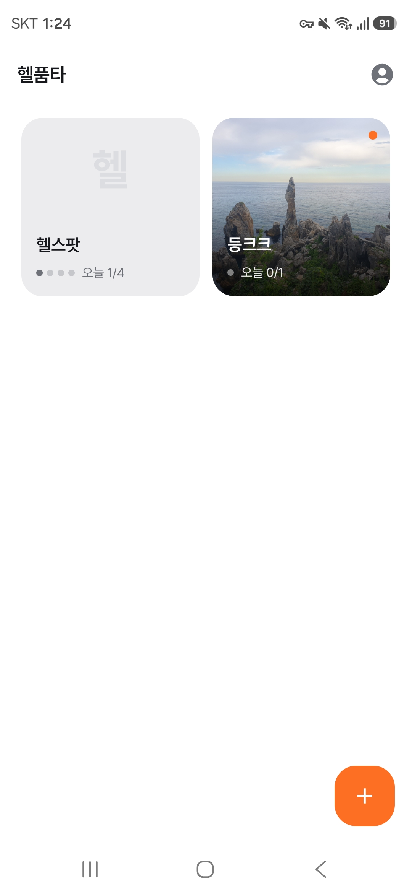
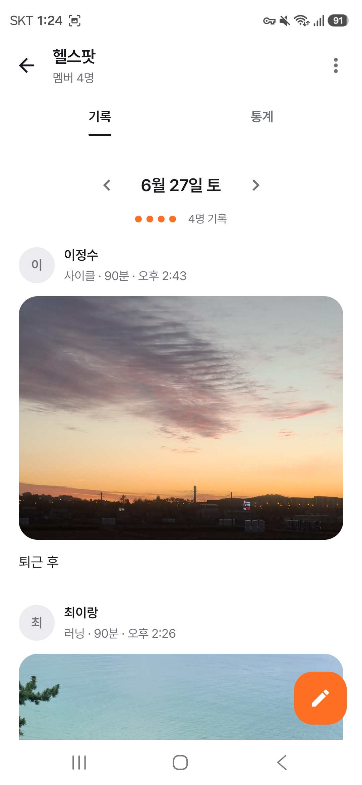
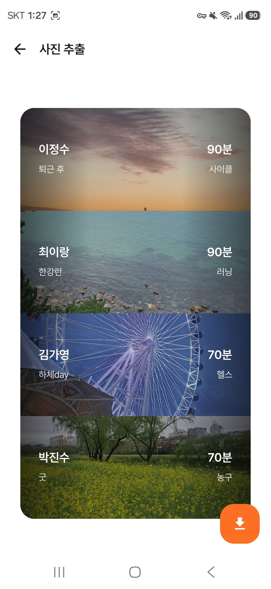
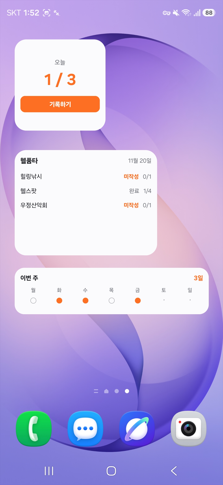
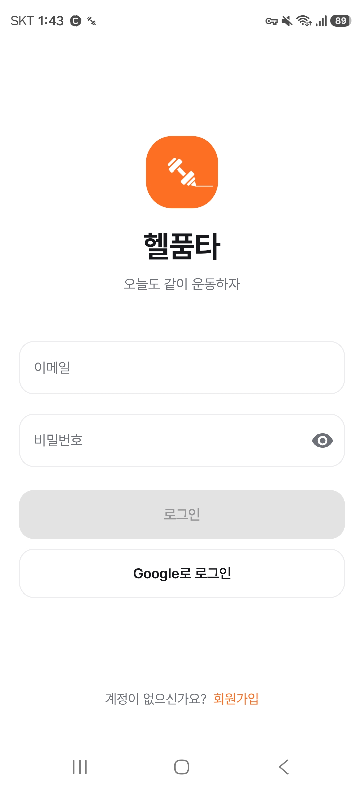

# 💪 헬품타 (Helpumta)

[](https://play.google.com/store/apps/details?id=com.jinsupark.helpumta)

친구들과 그룹을 만들어 운동 기록을 공유하고, 하루의 기록을 한 장의 이미지로 추출하는 Android 운동 기록 앱입니다.

- **실제 출시 · 운영 중** — Play 비공개 테스트(12명 / 14일)를 거쳐 2026.08 프로덕션 출시, 현재 v1.0.5
- **Clean Architecture + MVI** — 위젯까지 같은 레이어 경계를 지키는 일관된 구조
- **서버까지 직접 설계** — Firestore · Storage 보안 규칙, Cloud Functions(알림 · 삭제 정리), App Check
- **숫자로 남긴 개선** — 업로드 용량 6MB → 400KB(93%↓), 앱 크기 21.5MB → 7.34MB(66%↓)
- 🔁 같은 앱을 Flutter로 재구현하고 설계 차이를 비교: [헬품타 Flutter](https://github.com/JinsuPark01/helpumta-flutter)

> 📝 버전별 구현 상세와 트러블슈팅 전체(30여 건): **[UPDATES.md](docs/UPDATES.md)**

---

## 📷 Screenshots

|           홈           |        그룹 상세         |          통계           |         사진 추출          |
|:---------------------:|:--------------------:|:---------------------:|:----------------------:|
|     |  |  |     |
|       운동 기록 작성        |        날짜별 조회         |         그룹 참여          |         마이페이지          |
|   |    |     |    |
|      홈 화면 위젯 3종       |       리마인더 알림        |          로그인          |                        |
|   |     |    |                        |

---

## ⚙️ 주요 기능

- **그룹** — 초대 링크(App Links)로 참여, 최대 4명(트랜잭션으로 동시 가입 방어), 멤버 누구나 정보 수정
- **운동 기록** — 종목 · 시간 · 인증샷 · 소감 (하루 1회), 당일 수정 · 삭제, 최근 종목 자동완성
- **리액션** 💪 🔥 👏 — 맵 필드의 **내 키만** 갱신해 동시 입력에도 트랜잭션 없이 처리, 낙관적 UI
- **사진 추출** — 하루치 그룹 기록을 한 장으로. 템플릿 4종 × 비율 3종 × 색상 6종, 드래그로 순서 변경. 캔버스를 고정 크기로 그려 미리보기 크기와 무관하게 같은 해상도로 저장
- **통계** — 주간 요일별 차트, 월간 집계, 그룹원 비교 (같은 운동을 여러 그룹에 올릴 수 있어 그룹 범위로 한정)
- **리마인더 알림** — 매일 21시, 오늘 기록이 없는 사람에게만 사용자당 1건 (Cloud Functions + Scheduler + FCM)
- **홈 화면 위젯 3종** (Glance) — 오늘 기록 / 그룹 현황 / 이번 주
- **이미지 압축** — 장변 1920px · JPEG q85 + EXIF 회전을 픽셀에 직접 적용 → 평균 6MB → 400KB
- **디자인** — 홈에 `●●○○ 오늘 1/4` · 미작성 배지로 "오늘 썼나"를 바로 보이게, 화면마다 제각각이던 이미지 비율 통일, 위젯까지 같은 테마

---

## 🛠 Tech Stack

| 구분 | 기술 |
|---|---|
| Language · UI | Kotlin · Jetpack Compose · Navigation Compose · Glance |
| Design | Material 3 (색 스킴 · 타이포 전 슬롯 직접 정의) · Pretendard |
| Architecture | Clean Architecture (UI / Domain / Data) · MVI · Hilt |
| Async · Local | Coroutines · Flow · DataStore |
| Backend | Firebase Auth · Firestore · Storage · Hosting · FCM · App Check |
| Server | Cloud Functions (TypeScript) · Cloud Scheduler |
| Build | R8 (코드 축소 · 난독화 · 리소스 축소) |

---

## 🏗 Architecture

```
UI Layer        ──►  Domain Layer       ──►  Data Layer
(Compose,            (UseCase,                (Repository 구현,
 ViewModel,           Repository 인터페이스,    Firebase, DataStore,
 Contract)            Model · Policy)          Mapper)
```

- **Domain은 순수 Kotlin** — Android · Firebase 의존성 없음
- **UI는 반드시 UseCase 경유** — pass-through UseCase라도 경계를 위해 유지. 여러 Repository에 걸친 흐름(탈퇴, 그룹 나가기, 사진 추출)은 UseCase가 단일 진입점
- **위젯도 같은 경계** — Glance는 ViewModel을 쓸 수 없지만 Hilt `EntryPoint`로 UseCase만 참조
- **Repository는 저장 매체가 아니라 도메인 개념 단위** — 같은 DataStore를 써도 설정 / 운동 이력 / 추출 스타일은 각각의 Repository
- **MVI (Contract 통합)** — 화면별 `UiState` / `Intent` / `SideEffect`를 한 파일에, `Screen`(연결)과 `Content`(순수 UI) 분리

**에러는 레이어별로 책임을 나누고, 표시 방식은 "사용자가 무엇을 해야 하는가"로 정했습니다.**
Data가 Firebase 예외를 도메인 에러 타입으로 분류하고, UI가 한글 문구로 바꿉니다.

| 에러의 성격 | 처리 |
|---|---|
| 클라이언트가 미리 아는 입력 미비 | 버튼 비활성화 |
| 서버 응답으로 아는 입력 오류 | 입력 칸 아래 인라인 문구 |
| 재시도로 해결되는 동작 실패 | 토스트 (`SideEffect`) |
| 화면을 그릴 수 없는 로드 실패 | 화면 중앙 표시 |

```
com.jinsupark.helpumta/
├── ui/  domain/  data/  widget/  di/
functions/        # Cloud Functions — 리마인더 발송, 계정 · 그룹 삭제 정리
firestore.rules · storage.rules   # 보안 규칙 (레포에서 버전 관리)
```

---

## 🔧 Troubleshooting

### 1️⃣ 위젯이 갱신되지 않던 버그 — 틀린 가설 두 번

이미지가 **있는** 기록을 지울 때만 위젯이 갱신되지 않았다. "Storage 삭제를 기다리느라 늦는다"는 가설을 두 번 세웠고 둘 다 틀렸다. 특정 경로를 의심하는 걸 멈추고 갱신 메커니즘에 로그를 심자, **갱신이 15ms에 끝나고 데이터 조회는 첫 갱신 때만 찍혔다.** 네트워크 왕복이 없었다는 뜻이다.

```kotlin
override suspend fun provideGlance(context: Context, id: GlanceId) {
  val state = WidgetData.loadToday(context)       // ① 세션 시작 시 1회
  provideContent { GlanceTheme { Body(state) } }  // ② 갱신 요청마다 실행
}
```

`updateAll()`은 ②만 다시 실행하는데 데이터를 ①에서 읽고 있었다. "이미지 유무"처럼 보였던 건 우연이었고, 실제 규칙은 **"한동안 안 건드렸으면 되고, 방금 갱신했으면 안 된다"**(Glance 세션 수명)였다. → 데이터를 위젯 상태(state)에 넣는 구조로 바꾸고, 갱신당 조회도 3회 → 1회로 줄었다.

**교훈**: 가설이 반복해서 빗나가면 조건을 좁힐 게 아니라 전제를 의심해야 한다.

### 2️⃣ 보안 규칙은 필터가 아니다

기록 읽기를 "그룹 멤버만"으로 좁히는 규칙을 작성하고 쿼리를 전수 점검했다. Firestore는 실제 문서가 아니라 **쿼리가 반환할 수 있는 결과 전체**로 규칙을 평가한다. 그래서 `groupId` 조건 없이 `userId ==`만 거는 쿼리(닉네임 일괄 변경)는, 결과가 전부 내 기록이어도 **쿼리 전체가 거부될** 상황이었다.

```
allow read: if isSignedIn() && (isRecordOwner() || isMemberOfRecordGroup());
```

본인 검사를 앞에 둬서 내 기록 쿼리는 쿼리 조건만으로 통과(그룹 문서 조회 없음)하고, 그룹 쿼리만 멤버 검사를 거친다. 그룹이 삭제돼 멤버 검사가 실패해도 본인 기록은 정리할 수 있다.

이 작업은 원래 "인증샷 한 장당 읽기 1건이 추가된다"고 보고 보류했던 것이다. 그런데 규칙의 문서 조회는 **쿼리 단위로 한 번** 평가되어 실제 비용은 쿼리당 +1이었다. 비용 판단의 전제가 틀려 있었다.

### 3️⃣ 규칙은 문서 단위로만 막는다 — 공개 문서에 섞인 이메일

`users` 문서는 그룹원 닉네임 · 프로필 사진 표시를 위해 로그인한 누구나 읽어야 한다. 그런데 같은 문서에 FCM 토큰과 이메일이 있어 **쿼리 한 번으로 전체 사용자 이메일을 수집할 수 있었다.** 보안 규칙은 필드 단위로 읽기를 막지 못한다.

- 토큰 → 본인만 읽는 하위 문서(`users/{uid}/private/fcm`)로 이동
- 이메일 → 옮기기 전에 **읽는 곳이 있는지** 확인. 마이페이지는 Auth에서 직접 읽고 있었으므로 **저장 자체를 중단** (지킬 필요 없는 데이터는 안 가지는 게 최선의 보호)
- 알림 Function은 전체 사용자 조회 대신 **대상자 토큰만** 읽게 바꿨다. 죽은 토큰 정리도 `lastUpdateTime` 전제조건 삭제로 바꿔, **발송과 정리 사이에 사용자가 새로 등록한 토큰까지 지우던 경합**을 막았다.

### 4️⃣ Auth가 지워진 뒤에는 아무도 정리할 수 없다 — 앱 정리 + 서버 안전망

탈퇴는 앱이 그룹 나가기 → 기록 · 사진 삭제 → 계정 삭제 순서로 처리한다. 중간에 앱이 꺼지면 데이터가 남는데, **Auth 계정이 지워진 뒤에는 모든 규칙이 로그인을 요구하므로 다시 정리할 방법이 없다.**

- Auth 삭제 트리거와 그룹 문서 삭제 트리거로 남은 기록 · 리액션 · 멤버십 · 파일을 정리하는 Cloud Function 추가. 탈퇴 → 마지막 멤버면 그룹 삭제 → 그룹 정리가 연쇄된다.
- 앱의 정리는 **즉시 반영용으로 유지**하고, Function은 놓친 것을 줍도록 **멱등**하게 작성했다.
- 이를 위해 Storage 경로에 소유자를 넣었다(`records/{groupId}/{uid}/…`). 기존 경로엔 올린 사람 정보가 없어 규칙이 소유권을 몰랐고, **남의 사진을 같은 경로로 덮어써 바꿔치기**하는 것도 가능했다.

작업 중 **탈퇴 흐름이 그룹 나가기 UseCase를 재사용하지 않고 같은 순서를 따로 적고 있던 것**도 발견했다. 나가기에 리액션 삭제를 추가했는데 탈퇴엔 반영되지 않았던 것이다. 탈퇴가 나가기 UseCase를 호출하게 바꿔 순서를 한 곳에서만 정의했다.

### 5️⃣ 주황만 넣었는데 화면이 베이지로 물들었다

`lightColorScheme(primary = 주황)`처럼 일부 슬롯만 지정했더니 카드·앱바가 베이지로 물들고 다크 모드에서 주황이 분홍 쪽으로 틀어졌다.

지정하지 않은 슬롯은 **M3 기본(보라 계열) 팔레트가 그대로 남는다.** primary를 따라가는 건 `surfaceTint` 하나뿐인데, 이 값이 **높이(tonal elevation)가 있는 표면에 덧칠**되어 카드·앱바가 베이지로 떴다. 남아 있던 보라 계열과 섞이면서 다크 모드 주황이 분홍으로 보인 것이다.

→ 라이트/다크 색 스킴을 전 슬롯 직접 정의. 타이포도 같은 이유로 **15개 슬롯을 전부 채웠다** — 비워 둔 슬롯은 시스템 폰트로 폴백되어 한 화면 안에서 글꼴이 섞인다.

**교훈**: 기본값이 촘촘한 디자인 시스템에서 "일부만 바꾸기"는 위험하다. 어떤 기본값이 내가 바꾼 값을 따라오는지 확인해야 한다.

### 6️⃣ 같은 URL, 다른 맥락 — 알림을 눌렀는데 참여 화면이 뜸

리마인더 알림이 초대 링크 URL을 그대로 재사용하고 있었다. URL이 같아도 맥락은 다르다. 카톡 초대는 "들어올래?"(참여 화면), 리마인더는 "네 그룹에 기록 남겨"(그룹 상세)다.

알림 전용 경로를 만드는 대신 **참여 화면이 멤버십을 보고 그룹 상세로 보내도록** 고쳤다. 이미 멤버인 사람이 초대 링크를 눌렀을 때도 똑같이 어색했기 때문에, **한 곳을 고쳐 두 입구가 함께 해결**된다. 멤버 조회가 실패하면 막지 않고 기존 흐름으로 보낸다. 중복 가입은 UseCase가 이미 막고 있다.

### 7️⃣ 만들지 않은 것들 — 오버스펙의 기준

추상화와 방어 코드는 **"지켜야 할 불변식이 있는가"**를 기준으로 넣었다.

- **트랜잭션** — 그룹 4명 제한처럼 동시성 불변식이 있을 때만. 리액션은 맵의 내 키만 갱신하게 설계해 **경합 자체를 없앴다.**
- **앱 내 알림 on/off** — 채널이 하나뿐이라 OS가 이미 채널별 스위치를 제공한다. 복사판은 "두 스위치를 안 어긋나게 맞추는" 비용만 만든다.
- **위젯 설정 화면** — 런처의 위젯 추가 화면이 이미 3종을 보여준다.
- **구버전 호환 코드** — 규칙 변경은 배포된 모든 버전에 즉시 적용되므로 보통은 전환 기간 코드가 필요하다. 실사용자 0명 시점이라 전환 코드 없이 새 구조로 바로 넘어가고, 출시 전 데이터를 정리했다.

반대로 pass-through UseCase는 코드가 늘어도 **레이어 일관성을 위해 유지**했다.

> 더 많은 트러블슈팅(App Check 검증 실패 52%의 원인, R8과 enum 저장값, Glance `SizeMode`, `runCatching`과 코루틴 취소 등)은 **[UPDATES.md](docs/UPDATES.md)**에 있습니다.

---

## 🚧 Roadmap

| 버전 | 시기 | 주요 내용 |
|---|---|---|
| v1.0.2 | 2026.08 | 프로덕션 출시 — 인원 제한 · 기록 수정/삭제 · 보안 규칙 · 이미지 압축 · App Links |
| v1.0.3 | 2026.11 | 홈 배치 설정 · 규칙 보안 구멍 수정 · 업로드 크기 제한 · App Check SDK |
| v1.0.4 (v8) | 2026.11 | 그룹 통계 · 리마인더 알림 · 위젯 3종 · UI 전면 개편 · API 키 제한(패키지명 + SHA-1) |
| v1.0.5 (v9) | 2026.11 | 리액션 · 프로필/그룹 수정 · 사진 추출 커스텀 · **보안 정비**(규칙 · Storage 소유권 · 삭제 정리 Function · App Check enforce · R8) |

**진행 예정 (v10)** — 위젯 크기 조절 + 크기별 레이아웃, 주간 운동 목표, Authentication App Check enforce

**인지된 기술 부채**
- 날짜 유틸(`isSameDay` / `startOfDay`)이 Screen · ViewModel에 중복, "하루 1회 · 당일만 수정" 규칙을 Domain `Policy`로 승격
- 토스트 발생 경로 일원화 (일부는 Screen 직접, 일부는 `SideEffect`)
- `WidgetData`와 `GetGroupsWithTodayUseCase`의 동일 로직 중복
- 멀티모듈 + 테스트 코드 (학습 단계)